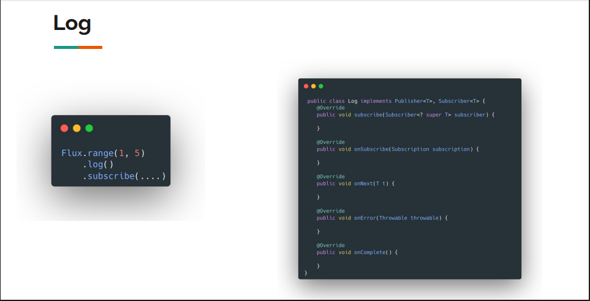

# Log Operator in Project Reactor

## Overview
The `log()` operator is a debugging tool in Project Reactor that helps visualize the communication between publishers and subscribers in a reactive stream.

## Purpose
- **Debugging**: Track what's happening between the producer and subscriber
- **Visibility**: See all signals (subscription, requests, onNext, onComplete, onError)
- **Troubleshooting**: Identify why items are not being received by subscribers

## How It Works

### The Log Operator as a Middleman
```
Producer ←→ Log Operator ←→ Subscriber
```

The `log()` operator implements both:
- **Publisher** interface (for the upstream producer)
- **Subscriber** interface (for the downstream subscriber)

It acts as an intermediary that:
1. Subscribes to the producer
2. Receives requests from the subscriber
3. Logs all communication
4. Passes signals between both ends



## What Gets Logged

### 1. **onSubscribe**
When the log operator subscribes to the producer:
```
onSubscribe([subscription object])
```

### 2. **request**
When the subscriber requests items:
```
request(unbounded) // Long.MAX_VALUE
request(3)         // bounded request
```

### 3. **onNext**
When items are emitted:
```
onNext(1)
onNext(2)
onNext(3)
```

### 4. **onComplete**
When the producer finishes emitting:
```
onComplete()
```

### 5. **onError**
If an error occurs:
```
onError([throwable])
```

## Code Examples

### Basic Usage
```java
public static void fluxLog() {
    Flux.range(1, 5)
        .log()
        .subscribe(Util.subscriber());
}
```

**Output:**
```
onSubscribe
request(unbounded)
onNext(1) - received: 1
onNext(2) - received: 2
onNext(3) - received: 3
onNext(4) - received: 4
onNext(5) - received: 5
onComplete - received complete
```

### With Bounded Request
```java
Flux.range(1, 5)
    .log()
    .subscribe(Util.subscriber(3)); // Request only 3 items
```

**Output:**
```
onSubscribe
request(3)
onNext(1) - received: 1
onNext(2) - received: 2
onNext(3) - received: 3
// No onComplete (more items available but not requested)
```

### With Multiple Operators
```java
public static void fluxLog() {
    Flux.range(1, 5)
        .log()
        .map(i -> i + ". " + Util.faker().name().firstName())
        .subscribe(Util.subscriber());
}
```

**Important**: The log operator only sees what happens **between itself and its immediate subscriber**. In this case, it sees numbers (1, 2, 3...) but NOT the transformed names.

### Logging After Transformation
```java
Flux.range(1, 5)
    .log()  // Sees: 1, 2, 3, 4, 5
    .map(i -> i + ". " + Util.faker().name().firstName())
    .log()  // Sees: "1. John", "2. Jane", etc.
    .subscribe(Util.subscriber());
```

### Naming Log Operators
For better debugging clarity, you can name your log operators:

```java
Flux.range(1, 5)
    .log("between range and map")
    .map(i -> i + ". " + Util.faker().name().firstName())
    .log("map and subscriber")
    .subscribe(Util.subscriber());
```

This helps identify which part of the chain is producing which logs.

## Key Points

1. **Position Matters**: The log operator only sees signals between itself and its immediate downstream subscriber

2. **Multiple Logs**: You can add multiple log operators at different points in the chain to see transformations

3. **Request Propagation**: The log shows how many items are requested (bounded vs unbounded)

4. **Completion Signals**: onComplete is only called when the producer has no more items OR when the subscription is cancelled

5. **Debugging Tool**: Not meant for production use - adds overhead and verbose logging

## Common Use Cases

- Debugging why items are not reaching the subscriber
- Understanding backpressure behavior
- Verifying operator transformations
- Learning reactive streams behavior
- Troubleshooting complex operator chains

